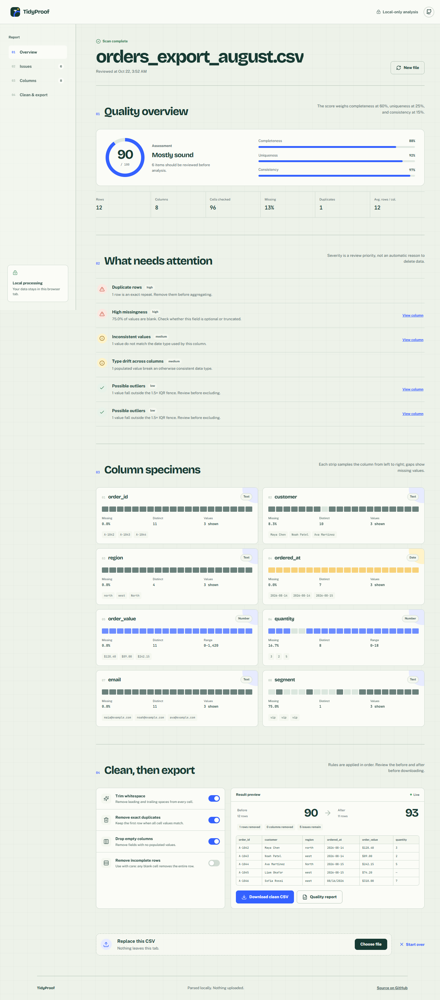

# TidyProof

[](https://github.com/LB-Y06/tidyproof/actions/workflows/deploy.yml)

**A private, browser-based quality check for messy CSV files.**

[Live demo](https://lb-y06.github.io/tidyproof/) · [Source code](https://github.com/LB-Y06/tidyproof)

TidyProof profiles a CSV before it reaches a spreadsheet, notebook, or dashboard. It finds missing values, duplicate rows, type drift, empty or constant columns, and numeric outliers, then produces a cleaned file and machine-readable quality report.

No server, account, upload, or analytics script is involved. Parsing and analysis happen inside the browser tab.


## What it does

- Profiles every column and infers `number`, `date`, `boolean`, `text`, or `empty`.
- Calculates completeness, uniqueness, and consistency, then combines them into a 100-point quality score.
- Flags exact duplicate rows, high missingness, constant columns, inconsistent value types, and IQR outliers.
- Shows the actual presence pattern for the first 20 rows in each column.
- Applies cleaning rules in a visible order: trim whitespace, remove duplicates, drop empty columns, and optionally remove incomplete rows.
- Exports a cleaned CSV and a JSON report containing the original analysis, cleaning settings, and post-cleaning analysis.
- Works offline after the first visit through a service worker.
- Includes responsive layouts, keyboard focus states, semantic tables, and reduced-motion support.

## Report view



## Stack

- React 19 + TypeScript
- Vite
- Papa Parse
- Vitest + Testing Library
- GitHub Actions + GitHub Pages

## Run locally

```bash
npm install
npm run dev
```

Open `http://localhost:5173`. Choose a CSV or use the included sample.

## Verify

```bash
npm test
npm run build
```

The test suite covers CSV parsing edge cases, duplicate headers, type inference, missingness, IQR outliers, cleaning rules, score labeling, and the end-to-end sample report flow.

## Engineering notes

The quality engine is separated from the React interface:

```text
src/lib/
  csv.ts        CSV normalization and parsing
  quality.ts    profiling, scoring, issue detection, cleaning
  demo.ts       deterministic sample dataset
```

The functions in `quality.ts` are pure and testable without a browser. The UI consumes their output and keeps credentials, uploads, and persistent user data out of the architecture entirely.

The quality score uses three explainable inputs:

```text
score = 60% completeness + 25% uniqueness + 15% consistency
```

Outliers are reported for review but are never removed automatically. Likewise, high missingness is prioritized by severity instead of being silently imputed.

## Privacy and limits

- Files are limited to 12 MB in the UI.
- Only `.csv` files are accepted; XLSX and delimiter inference for non-CSV files are out of scope.
- Text columns are intentionally inferred broadly, so business rules still need human review.
- `localStorage` is not used, so refreshing the page clears the active report.

## Deployment

Every push to `main` runs tests and the production build. The workflow publishes `dist/` to GitHub Pages using GitHub's official Pages actions.

## License

MIT
